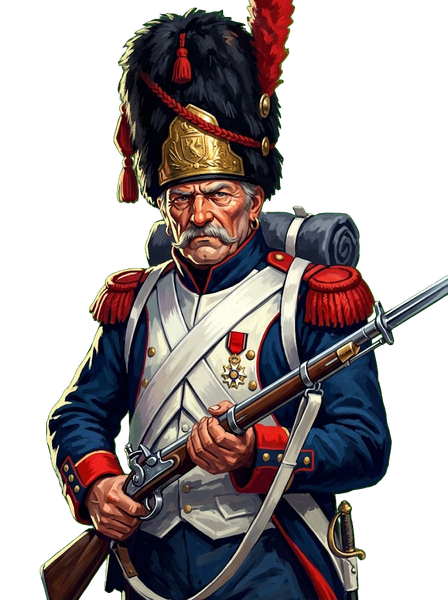
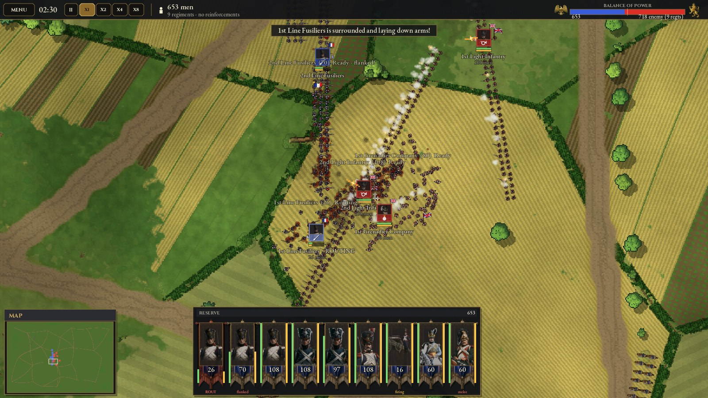
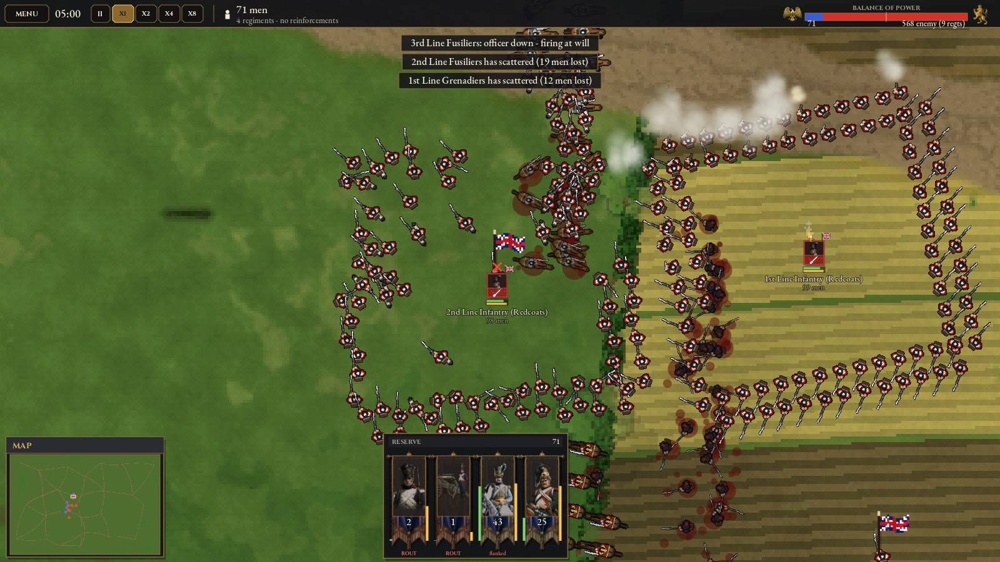
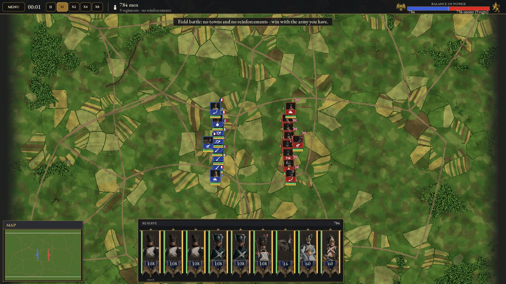
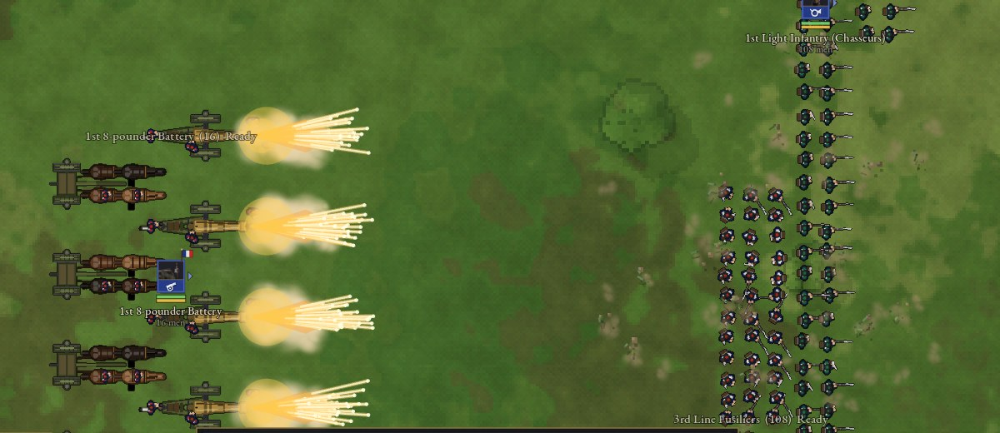
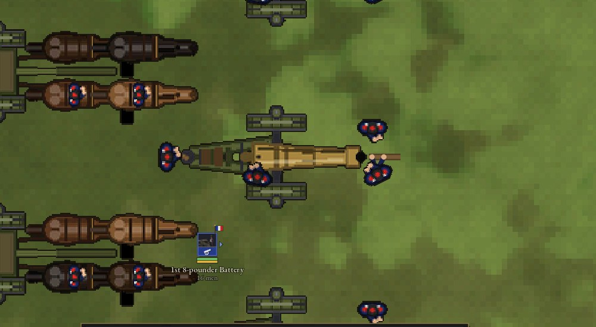

<div align="center">



# Napoleon Wars 2D

A top-down real-time tactical battle game set in the Napoleonic era.
You command regiments of infantry, cavalry and artillery — every soldier is simulated individually.


</div>

## About

- **Field battles and a campaign mode** — 9 scenarios: from a skirmish between two brigades to a clash of full corps, a last stand at three-to-one odds, and *Conquest* with towns, gold and recruitment.
- **Three arms** — infantry (line, square, volleys on command), cavalry (line, wedge, charge) and artillery (limbers and horse teams; round shot, shell and canister).
- **Morale and fatigue** — regiments waver under fire, break when hit in the flank, rout, rally, or surrender when surrounded.
- **Dozens of historical units** for France and Britain with their own portraits and uniforms; Austria, Russia and Prussia as additional sides.
- **Random battlefields** — 12 map types (open plain, river crossing, mountain pass, ridge on one flank, great forest and more) across several theatres of war and seasons.
- **Multiplayer** — host from inside the game or run a headless dedicated server.

## Screenshots



| | |
| --- | --- |
|  |  |
| Infantry squares against a cavalry charge | The whole battlefield — both armies deployed |
|  |  |
| Canister at close range | A gun crew at the loading drill |

## Requirements

- Windows (`.bat` launchers); `graj.sh` works in Git Bash.
- Godot **4.7.2** — no manual install needed: on first run the launcher downloads it into the `godot/` folder (about 70 MB) and imports the assets.

## Running

```bat
graj.bat      :: play
edytor.bat    :: open the project in the Godot editor
serwer.bat    :: dedicated server (no window)
```

The server accepts options, and players join through **Menu → Multiplayer → JOIN** (default port `24567`):

```bat
serwer.bat --port 24567 --scenario "Grand Battle" --map Highlands --size Large
```

In Git Bash:

```bash
./graj.sh              # run in the background
./graj.sh --konsola    # with logs in the terminal
./graj.sh --server --scenario "Grand Battle" --map Highlands --size Large
```

`graj.sh` does not download Godot — it looks for it in `PATH` or at the path in the `GODOT` variable.

## Controls

| Key / mouse | Action |
| --- | --- |
| LMB, drag | Select a regiment / box select |
| RMB | Move order; on an enemy — fire or charge. Drag to set the facing and width of the formation |
| Mouse wheel | Zoom to cursor |
| `W` `A` `S` `D`, arrows, middle button | Pan the camera |
| `Space` (hold) | Show all units and orders |
| `H` | Halt |
| `Q` | Square (infantry) |
| `V` | Wedge (cavalry) |
| `T` | Fire at will / fire on orders only |
| `B` | Battery ammunition: auto, round shot, shell, canister |
| `G` / `U` | Form an army from the selection / leave the army |
| `1`–`9`, `Ctrl`+`1`–`9` | Select an army / assign to an army |
| `Ctrl`+`A` | Select all your regiments |
| `F` | Camera to selection |
| `C` | Camera to your capital |
| `P` | Pause (single player only) |
| `+` / `-` | Faster / slower, up to ×8 (single player only) |
| `Esc`, `F1` | Menu |
| `Ctrl`+`R` | Restart the battle |

## Project structure

```
scripts/     game logic (GDScript)
  battle.gd      the battle: units, scenarios, AI, player orders
  regiment.gd    a regiment: formation, movement, fire, melee, morale, drawing
  terrain.gd     map generator and terrain
  overlay.gd     interface and menus
  net.gd         multiplayer
shaders/     terrain shader
scenes/      main scene
assets/      unit portraits, fonts, music, sounds
docs/        screenshots for this README
data/        uniform data
tools/       helper scripts for preparing portraits
```

Unit portraits can be replaced without the editor — see [`assets/units/README.txt`](assets/units/README.txt) (in Polish).

## License

The repository does not include a license file for the game code yet. The Cinzel and EB Garamond fonts are under the SIL Open Font License — see [`assets/fonts/`](assets/fonts/).
